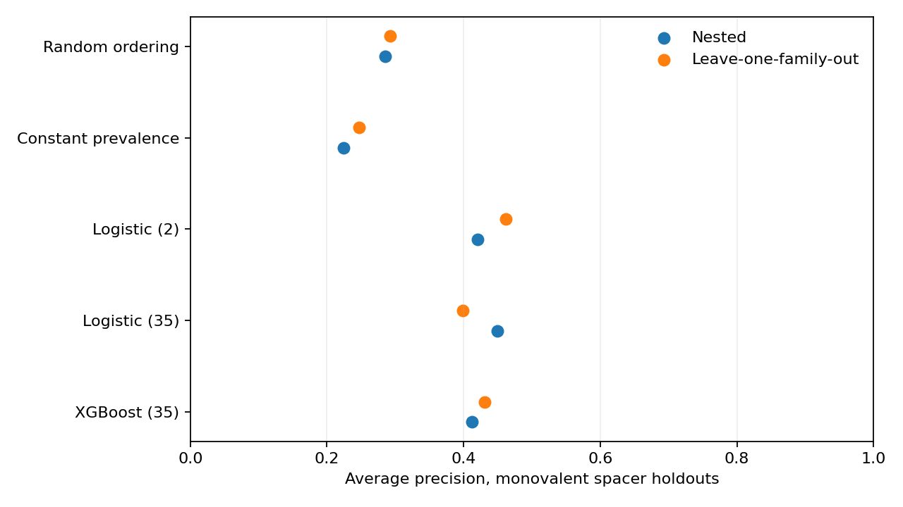
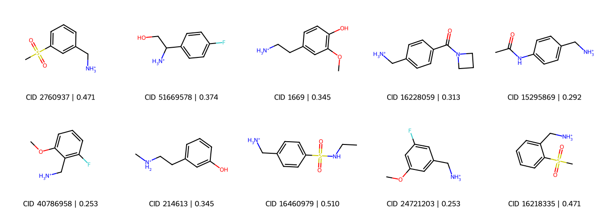
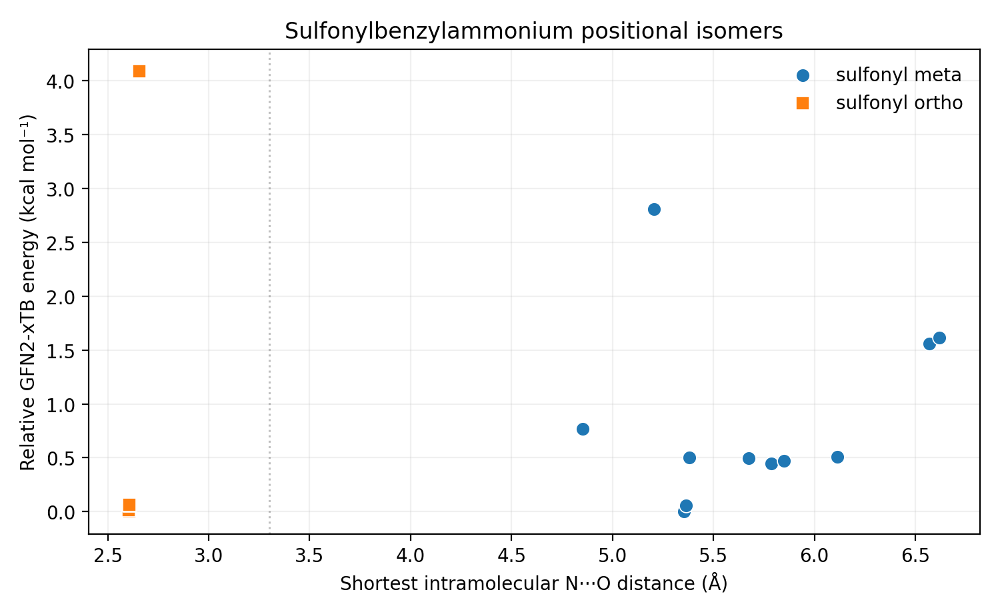

# Molecular prioritization of organic spacers for layered perovskite solar cells

Organic spacer cations influence the structure and performance of layered halide perovskites, but published device results cover relatively few distinct molecules. This project uses molecular descriptors and reported solar-cell measurements to rank spacer candidates for experimental screening.

The dataset contains 749 qualifying devices from 134 publications and 42 identified spacer cations, including 31 monovalent cations. The analysis combines publication-aware adjustment of device performance, molecular-level validation, and screening of PubChem-derived amine candidates.

## Dataset and methods

The device data were assembled from [Choi et al., *Solar Energy* 303 (2026) 114112](https://doi.org/10.1016/j.solener.2025.114112) and the associated [data deposit](https://doi.org/10.7924/r40g3xh1d).

We retained records with one identified spacer cation and represented each reported ionic species with 35 RDKit descriptors. A ridge regression model accounts for device composition, architecture and processing conditions. DOI-grouped out-of-fold PCE residuals are aggregated by spacer identity; molecules above the 80th percentile form the positive class.

Logistic regression with two or 35 descriptors and XGBoost with 35 descriptors were compared using repeated held-out spacer splits and leave-one-molecular-family-out evaluation. Context fitting and label thresholds are recalculated within the training partitions.

[Methods](docs/methods.md) · [Chemical representation](docs/chemical-representation.md)

## Model evaluation



Average precision (AP) for the 31 monovalent spacers:

| Model | Chemistry holdout | Family holdout |
| --- | ---: | ---: |
| Random ranking | 0.285 | 0.292 |
| Logistic regression, 2 descriptors | 0.420 | 0.462 |
| Logistic regression, 35 descriptors | 0.449 | 0.398 |
| XGBoost, 35 descriptors | 0.412 | 0.431 |

The two-descriptor logistic model (MolLogP and carbon-heavy-atom fraction) was retained for candidate screening. Model choice followed inspection of the exploratory validation results, so the AP values should be read as model comparisons pending an independent experimental test.

Publication coverage remains uneven: five of the seven positive monovalent spacers have device evidence from only one DOI. The source-deletion and family-holdout analyses are provided alongside the main results.

[Full benchmarks](results/clean_study1/benchmark.csv) · [Held-out predictions](results/clean_study1/heldout_predictions.csv) · [Publication sensitivity](results/clean_study1/positive_source_stability.csv) · [Family diagnostics](results/clean_study1/family_level_diagnostics.csv)

## Candidate screening



The virtual screen starts from 13,595 PubChem retrieval records. Chemical filtering yields 3,296 eligible ionic structures, of which 2,087 are monovalent. Candidates are scored with 30 bootstrap fits of the selected logistic model and filtered by model score, molecular similarity to training spacers, and estimated synthetic accessibility. The intersection retains 121 molecules; Pareto filtering reduces this to 74, followed by diversity selection of ten structures.

The ten selected molecules fall within the empirically defined moderate-extrapolation range, with maximum Morgan similarity to a training monovalent spacer of approximately 0.31–0.41. The model scores are uncalibrated, and the shortlist order reflects diversity selection rather than descending predicted score.

[Ten-molecule shortlist](results/clean_study1/shortlist.csv) · [All monovalent candidate scores](results/clean_study1/candidate_scores.csv) · [Screening counts](results/clean_study1/screening_counts.json)

## Quantum-chemical comparison

Two positional-isomer pairs in the shortlist have identical scores from the selected two-descriptor model. We examined their conformations using RDKit, GFN2-xTB, and CREST; the methylsulfonylbenzylammonium pair was also evaluated with PBE0/def2-SVP single-point DFT.



For the meta isomer, none of the 11 CREST conformers within 3 kcal/mol of the minimum has an intramolecular N–H···O contact. All four low-energy ortho conformers meet the same geometric criterion. PBE0 single-point calculations on the lowest structures, with an implicit DMF dielectric, place the ortho isomer 3.46 kcal/mol below the meta isomer in electronic energy.

The calculations identify a conformational difference that is absent from the molecular ranker. Its effect on ammonium–iodide coordination and device processing remains to be investigated.

[Computational methods and results](docs/quantum_chemistry.md) · [CREST conformer data](results/quantum_pilot/crest_conformers.csv) · [DFT energies](results/quantum_pilot/dft_singlepoints.csv)

## Experimental follow-up

The proposed validation compares four high-ranked candidates with four chemically matched middle- or lower-ranked candidates and four score-blind selections. Two established spacer compounds serve as batch references. The plan uses a common fabrication procedure, three independent batches and six devices per chemistry per batch, with PCE evaluated at the molecular level.

Fabrication and prospective model testing have not yet been performed.

[Experimental protocol](docs/experimental-validation.md)

## Code and data

```bash
# Python 3.13
pip install -e . pytest

# Check the released tables and figures against their SHA-256 hashes
python scripts/verify_results.py

# With the original input matrices and PubChem pool available
python scripts/run_clean_study1.py --check
python scripts/run_clean_study1.py --rebuild
```

The repository includes the analysis code, generated results, model diagnostics and candidate structures. The complete source matrices, curated ionic registry and original PubChem snapshot are kept separately; rebuilding requires the exact inputs described in [data/README.md](data/README.md). Source and output fingerprints are recorded in the [results manifest](results/clean_study1/manifest.json).

The main entry point is [`scripts/run_clean_study1.py`](scripts/run_clean_study1.py). Molecular feature generation and model evaluation are in [`src/perovskite_prioritization/`](src/perovskite_prioritization/), with tests in [`tests/`](tests/).

[Reproducibility notes](docs/reproducibility.md) · [License](LICENSE) · [Citation](CITATION.cff)
