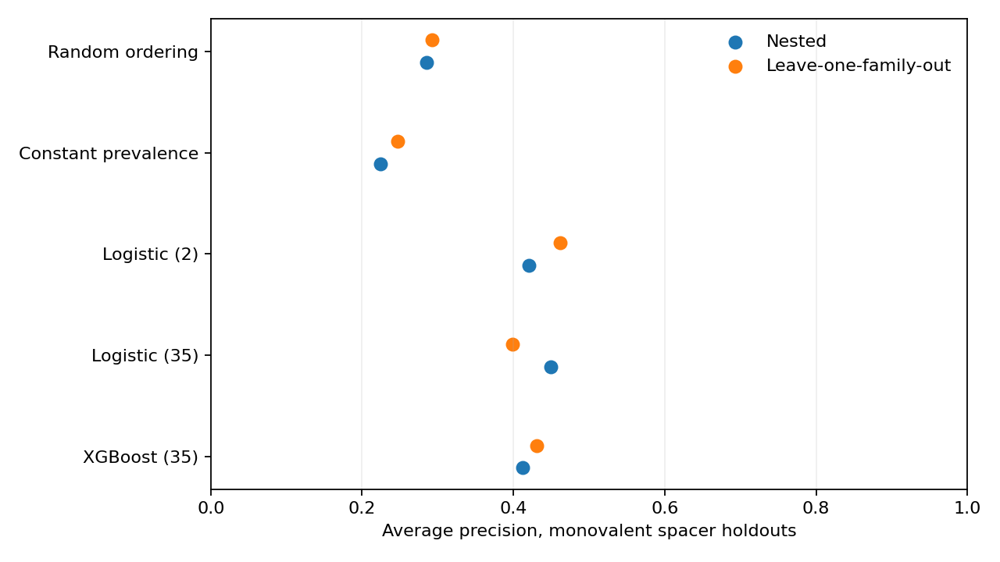
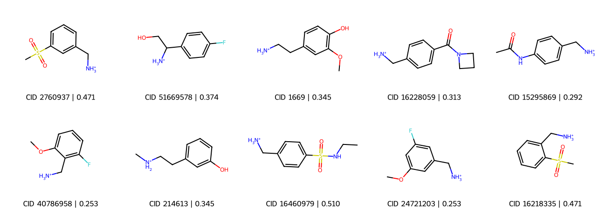
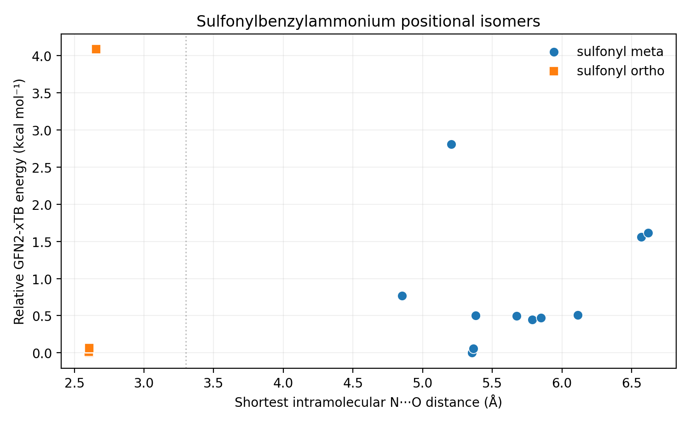

# Molecular Prioritization of Organic Spacers for Layered Perovskite Solar Cells

This project uses published device measurements to prioritize organic spacer cations for layered perovskite solar cells. Publication-aware context adjustment converts literature PCE records into spacer-level performance labels. Interpretable molecular models then guide a PubChem screen, yielding ten candidate structures. Calculations on two shortlisted positional-isomer pairs examine local conformations and iodide interactions that the selected descriptors cannot distinguish.

## Dataset and Approach

The device records come from [Choi et al., *Solar Energy* 303 (2026), 114112](https://doi.org/10.1016/j.solener.2025.114112) and the accompanying [Duke data deposit](https://doi.org/10.7924/r40g3xh1d). Of 792 source records, 749 contain one identified spacer and meet the study criteria. They cover 134 publications and 42 spacer identities. The main ranking analysis uses the 31 monovalent spacers; the full 42-spacer cohort is reported separately.

A ridge context model adjusts for recorded composition, device architecture, area, transport layers and their deposition methods. DOI-grouped out-of-fold PCE residuals are summarized by their median for each spacer. An empirical upper-quintile threshold defines the classification target. The ionic structures are represented by 35 RDKit descriptors.

For each held-out spacer split, context fitting and the label threshold use the training chemistry. A separate source-disjoint analysis examines dependence on publications shared across spacer identities. These targets describe literature-associated molecular performance after adjustment for the available device context.

[Methods and validation protocols](docs/methods.md) · [Ionic representation](docs/chemical-representation.md) · [Dataset definitions](data/README.md)

## Model Evaluation



Average precision (AP) on the **same 31-spacer cohort**:

| Model | Repeated spacer holdout | Molecular-family holdout |
| --- | ---: | ---: |
| Random ranking | 0.285 | 0.292 |
| Logistic regression, 2 descriptors | 0.420 | 0.462 |
| Logistic regression, 35 descriptors | 0.449 | 0.398 |
| XGBoost, 35 descriptors | 0.412 | 0.431 |

Repeated holdout uses ten repetitions of five-fold spacer splits; AP is computed from each repetition's pooled held-out predictions. The figure labels this protocol “Nested” because the targets are reconstructed inside the outer splits. Family AP pools predictions from eight excluded-family fits. Two families contain both target classes, so pooled family AP also reflects ordering between families.

The 35-descriptor logistic model has the highest repeated-holdout AP. The two-descriptor model, using **MolLogP and carbon-heavy-atom fraction**, provides a compact chemical interpretation and was retained for screening after exploratory inspection of both validation settings. Its reported AP is therefore an exploratory model comparison, not an independent estimate after model selection.

Five of the seven positive monovalent spacers have evidence from one DOI. Publication deletion, source-disjoint evaluation and family diagnostics accompany the main benchmark.

[Frozen benchmarks](results/clean_study1/benchmark.csv) · [Held-out predictions](results/clean_study1/heldout_predictions.csv) · [Source sensitivity](results/clean_study1/positive_source_stability.csv) · [Family diagnostics](results/clean_study1/family_level_diagnostics.csv)

## Molecular Screening

The screen starts from 13,595 PubChem retrieval records. Chemical eligibility checks and amine-site protonation produce 3,296 candidate ionic representations, including 2,087 monovalent candidates. Thirty bootstrap fits of the selected logistic model provide a mean score and score variation for each candidate.

Selection combines model score, similarity and descriptor distance to training molecules, estimated synthetic accessibility, Pareto filtering and molecular diversity. The score/domain/accessibility intersection contains 121 candidates; 74 are Pareto-optimal. Diversity selection gives the final ten structures.



All ten fall in the screen's empirical moderate-extrapolation category, with maximum Morgan similarity to a training spacer of 0.314–0.407. The CSV records the neutral precursor and modeled cation for each CID. Shortlist order follows diversity selection; scores are uncalibrated classifier outputs. The shortlist is a set of candidates for experimental testing, and no prospective fabrication or PCE validation is included.

[Ten-candidate shortlist](results/clean_study1/shortlist.csv) · [All monovalent scores](results/clean_study1/candidate_scores.csv) · [Filter counts](results/clean_study1/screening_counts.json)

## Quantum-Chemical Analysis

Two shortlisted positional-isomer pairs receive identical two-descriptor scores: meta/ortho methylsulfonylbenzylammonium and two fluoro/methoxybenzylammonium regioisomers. RDKit conformers, GFN2-xTB optimizations and CREST sampling resolve differences in their local ammonium–oxygen geometry.



Within 3 kcal/mol of the CREST minimum in implicit DMF, none of the 11 meta conformers meets the stated intramolecular N–H···O contact criterion; all four low-energy ortho conformers do. PBE0/def2-SVP single-point energies on the lowest CREST/GFN2-xTB structures, using ddCOSMO with a DMF dielectric, place the **isolated ortho cation 3.46 kcal/mol below meta**.

Adding one explicit iodide gives a different comparison: electronic association relative to the separated cation and iodide. In implicit DMF, association is more favorable for **meta by 3.58 kcal/mol at GFN2-xTB and 3.64 kcal/mol at PBE0/def2-SVP**. The fluoro/methoxy pair favors isomer B by 1.54 kcal/mol at GFN2-xTB. DFT geometries remain fixed at the GFN2-xTB minima. These isolated-cation and ion-pair energies describe local molecular interactions; they do not quantify film stability or changes in device PCE.

[Conformer methods and energies](docs/quantum_chemistry.md) · [Iodide association and reference states](docs/iodide_association.md) · [Raw DFT energy table](results/iodide_pilot/dft_pair_singlepoints.csv)

## Code and Reproducibility

Python 3.13 and pinned packages are specified in [pyproject.toml](pyproject.toml). From the repository root:

```bash
python -m pip install -e ".[test]"
python scripts/verify_results.py
python scripts/verify_repository.py
python scripts/run_iodide_reference.py --check-only
python -m pytest -q
```

These commands inspect stored artifacts and run tests without retraining the ranking models or launching quantum calculations. Tests requiring the nonredistributed source inputs are skipped in a public checkout. The [results manifest](results/clean_study1/manifest.json) records the frozen input/code fingerprints, parameters and output hashes.

A complete rebuild requires the exact device matrices, curated ionic registry and PubChem snapshot described in [data/README.md](data/README.md), plus a LaTeX installation. Instructions for checking those inputs and rebuilding are in [docs/reproducibility.md](docs/reproducibility.md). The repository includes `src/`, analysis and calculation `scripts/`, `tests/`, and three result directories for molecular ranking, conformers and iodide association.

[Reproducibility guide](docs/reproducibility.md) · [Proposed experimental validation](docs/experimental-validation.md) · [Code license](LICENSE) · [Citation](CITATION.cff)
